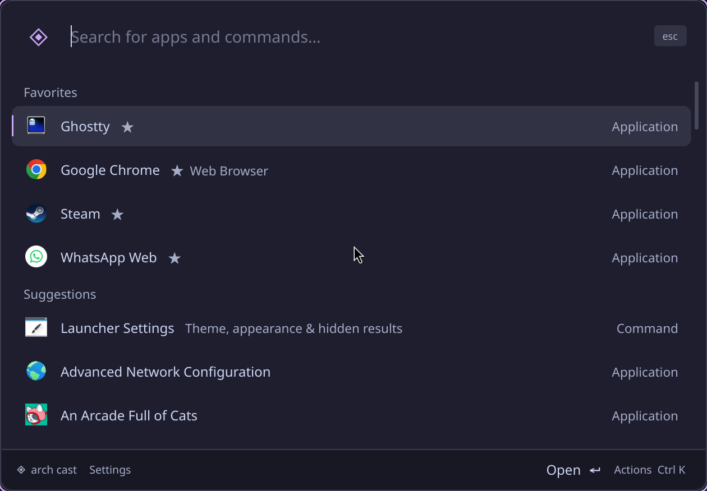

# Arch Cast

A keyboard-first native application launcher for Arch Linux and Hyprland, written in Rust with [GPUI](https://gpui.rs/). No Python, Qt, Electron, webview, telemetry, plugins, or network services. Search stays local until you choose a web search.

Press **Super+Space** to toggle it. The default theme is Catppuccin Mocha.



## What it does

- Searches installed applications, including user overrides, nested desktop entries, and Chrome web apps.
- Matches names, acronyms, keywords, aliases, and abbreviations. Learns searches and ranks by frequency and recency.
- Saves favorites, aliases, hidden results, and recent searches.
- Provides a searchable Ctrl+K action panel.
- Calculates arithmetic such as `12 * (3 + 4)` and `2^8`. Enter copies the answer without closing the launcher.
- Offers Google and DuckDuckGo fallback searches. Queries are URL-encoded, never executed as shell commands.
- Previews themes, individual hex colors, fonts, font sizes, and window widths in settings. Includes color pickers and hidden-result restoration.
- Runs explicit, user-authored custom commands from configuration.
- Keeps one resident process with a user-only Unix socket. Windows close when dismissed; the process remains ready for the next shortcut.

## Build and install

Requires a current stable Rust toolchain, a Vulkan-capable graphics driver, and Hyprland with its Lua configuration API. The installer expects `hyprland.lua` to contain a `local menu = ...` line referring to Rofi or Arch Cast. Older Hyprlang configuration files are not supported.

On Arch Linux, install the build and desktop dependencies:

```sh
sudo pacman -S --needed base-devel clang cmake pkgconf rust \
  wayland libxkbcommon fontconfig vulkan-icd-loader libxcb libx11 \
  gtk3 xdg-utils
```

Install the Vulkan driver appropriate to your GPU as well, for example `vulkan-intel` or `vulkan-radeon`. NVIDIA users need the Vulkan support supplied by their driver. Application icons come from your installed icon themes.

```sh
cargo build --release --locked -j 2
./target/release/arch-cast install
~/.local/bin/arch-cast show
```

The first build compiles GPUI and its dependencies. `-j 2` limits build-time memory use. The executable does not require Rust, Cargo, Python, or this checkout at runtime. It still uses the system graphics, font, and Wayland/X11 libraries, plus `gtk-launch` and `xdg-open`.

The installer:

1. Backs up your Hyprland configuration under the launcher's config directory.
2. Copies the executable to `~/.local/bin/arch-cast` and writes a desktop entry.
3. Replaces only the launcher menu command and the marked Arch Cast window/session block.
4. Reloads Hyprland. If the compositor rejects the config, restores the files it changed.

The window rule disables Hyprland's compositor border only for the `arch-cast` app class. Other windows keep their normal borders; the launcher's own themed outline is unchanged.

Rofi and your original Rofi scripts remain installed. Reinstall after rebuilding to update the installed executable. Installing stops an old resident so the next invocation uses the new binary.

To restore the previous launcher:

```sh
arch-cast uninstall
```

Uninstall preserves settings, backups, and later unrelated Hyprland edits. Existing installation manifests from the Python version are supported, including their original Rofi binding.

## Keyboard

| Key | Action |
| --- | --- |
| Super+Space | Toggle launcher through Hyprland |
| Enter | Open selected result or copy calculator answer |
| Up / Down | Move selection |
| Ctrl+P / Ctrl+N | Move selection |
| Ctrl+Up / Ctrl+Down | Jump sections |
| Ctrl+1 through Ctrl+9 | Open numbered result |
| Ctrl+K | Toggle searchable action panel |
| Ctrl+Shift+F | Toggle favorite |
| Ctrl+Shift+C | Copy desktop ID or custom command |
| Alt+Shift+D | Hide selected application or custom command |
| Ctrl+, | Open settings |
| Ctrl+S in settings | Save changes |
| Up on empty search | Recall the most recent search |
| Ctrl+Plus / Ctrl+Minus / Ctrl+0 | Increase, decrease, reset font size |
| Esc | Close actions, then clear search, then dismiss |
| Esc in settings | Cancel unsaved appearance changes |
| Shift+Esc | Dismiss immediately outside settings |

Clicking outside dismisses the launcher. App launches detach from the launcher, so restarting it does not close your apps. The global shortcut belongs to Hyprland, not to a global keyboard hook in the app.

## Configuration

Settings live in `$XDG_CONFIG_HOME/arch-cast/config.json`, normally `~/.config/arch-cast/config.json`:

```json
{
  "theme": "Catppuccin Mocha",
  "colors": { "accent": "#cba6f7" },
  "font": "Noto Sans",
  "font_size": 12,
  "width": 840,
  "commands": []
}
```

Available presets are Catppuccin Mocha, Macchiato, Latte, and Tokyo Night. Color keys are `background`, `surface`, `selection`, `border`, `text`, `muted`, `accent`, and `success`. Valid `#rrggbb` overrides replace preset colors. An empty `colors` object uses the preset unchanged. Font size is 10–20 points and width is 640–1200 logical pixels.

Settings preview live. Save writes the appearance; Cancel restores the saved appearance. Restoring hidden results changes saved result visibility immediately, independently of appearance changes.

Favorites, aliases, hidden entries, usage, learned searches, and history live in `$XDG_STATE_HOME/arch-cast/state.json`, normally `~/.local/state/arch-cast/state.json`. Config and state writes use a temporary file and atomic rename. Existing files from the Python version work without conversion. Unknown configuration fields are preserved.

Edits to configuration and the application catalog load when a new launcher window opens. Refresh Applications also reloads them.

### Custom commands

Add an explicit command to `config.json`:

```json
{
  "commands": [
    {
      "id": "screenshots",
      "name": "Open Screenshots",
      "description": "Pictures / Screenshots",
      "icon": "folder-pictures",
      "keywords": "captures images",
      "command": "xdg-open \"$HOME/Pictures/Screenshots\""
    }
  ]
}
```

Custom commands intentionally run through `/bin/sh`. Only add commands you trust. Search input is never interpolated into these commands. Normal desktop entries launch by ID through GIO's `gtk-launch`, which handles desktop field codes, terminal applications, user overrides, and D-Bus activation.

## CLI

```sh
arch-cast toggle
arch-cast show
arch-cast hide
arch-cast quit
arch-cast doctor
arch-cast list ghostty
arch-cast run app:com.mitchellh.ghostty.desktop
arch-cast daemon
```

The first toggle/show/run starts the resident in the background. `daemon` runs it in the foreground for session startup or debugging. Logs are in `$XDG_STATE_HOME/arch-cast/launcher.log`. `list` and `doctor` do not open a window. `hide` and `quit` do not start a missing resident.

For development, use `cargo run -- show` or the built binary directly. `bin/arch-cast` is a convenience wrapper for the release build, not the installed executable.

## Development

```sh
cargo fmt --check
cargo clippy --all-targets --locked -- -D warnings
cargo test --locked
cargo run -- doctor
hyprctl configerrors
```

GPUI and its component library are pinned together through GPUI Kit 0.8.0. Commit `Cargo.lock` and build with `--locked` for reproducibility.

| Module | Responsibility |
| --- | --- |
| `src/catalog.rs` | Typed settings/state, ranking, history, favorites, themes |
| `src/calculator.rs` | Bounded arithmetic parser, with no code evaluation |
| `src/desktop.rs` | XDG desktop-file discovery and precedence |
| `src/ui.rs` | GPUI search window, action panel, alias editor, settings |
| `src/ipc.rs` | Resident lock, socket permissions, bounded request protocol |
| `src/platform.rs` | Detached launching, icon lookup, compositor focus, diagnostics |
| `src/install.rs` | Backup, install, rollback, and uninstall |
| `src/main.rs` | CLI and resident window lifecycle |

[Verification notes](docs/verification.md) describe automated and desktop checks.

Arch Cast is an independent implementation inspired by [oma-cast](https://github.com/typecraft-dev/oma-cast). It does not implement Raycast extensions or Omarchy-specific integrations.
