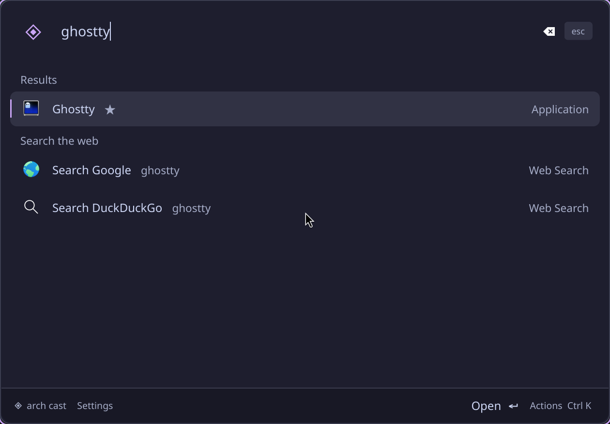
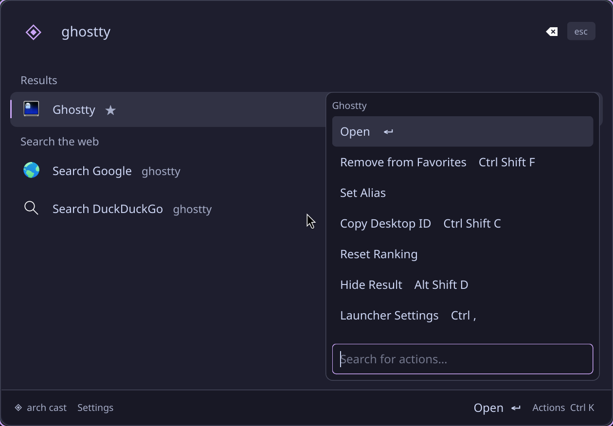
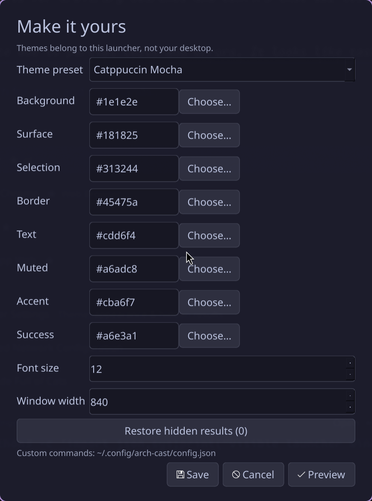
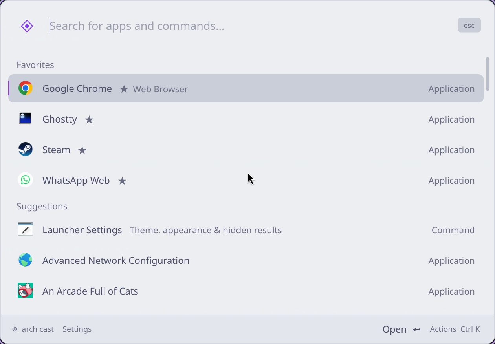
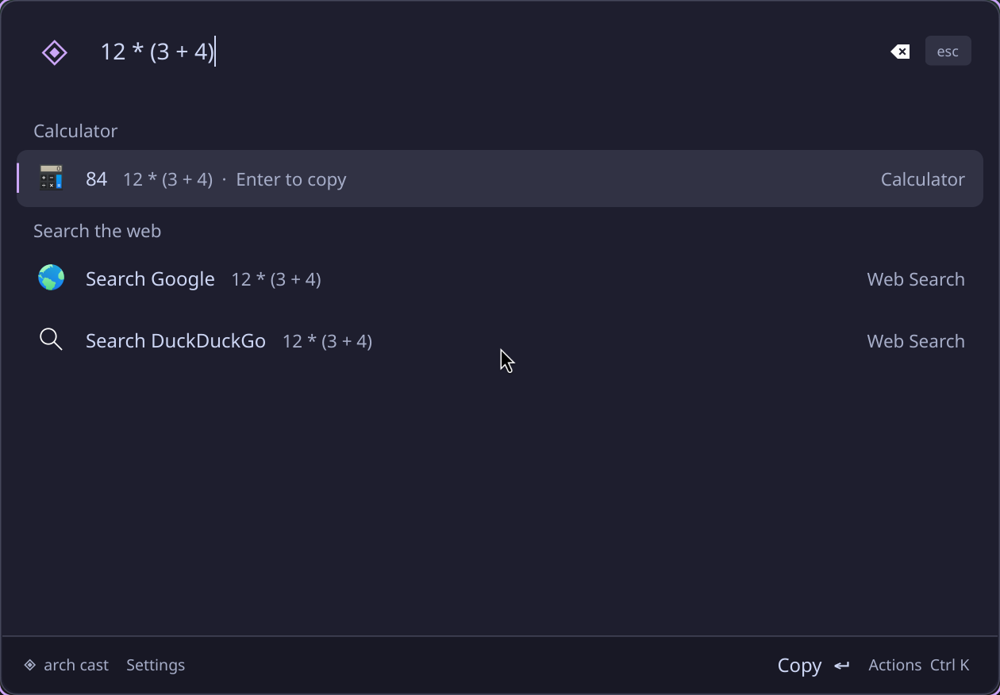
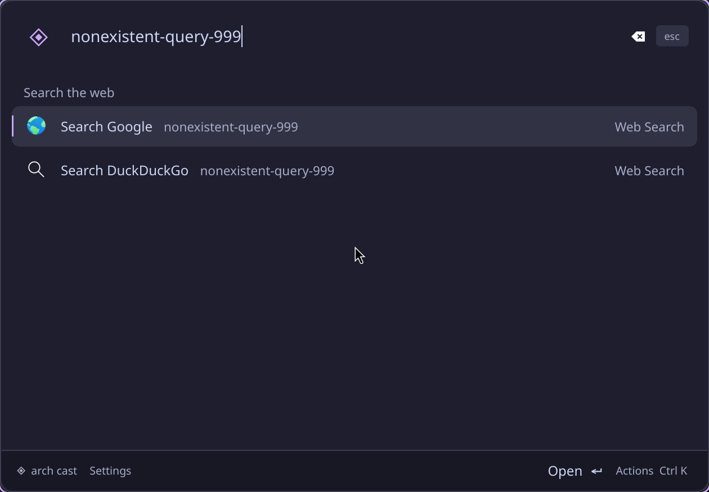

# Desktop verification

Verified on the actual Hyprland 0.56.2 Wayland session on 2026-10-20. These are captures of the running native window, not rendered mockups.

## Checks performed

- Opened the native accessibility tree and entered `ghostty` through the search field with the computer-use tool.
- Sent real Super+Space key events through a temporary uinput keyboard. Confirmed it opened Arch Cast, then toggled back to the existing terminal. The virtual keyboard was destroyed after each check.
- Opened Ctrl+K, filtered actions to Set Alias, assigned `gt` to Ghostty, and searched for `gt`. Removed that test alias afterward.
- Pressed Enter to launch Ghostty. Confirmed a new native Ghostty window appeared. Closed only that new test window; the user's original terminal remained open.
- Entered `12 * (3 + 4)`, pressed Enter, and read `84` from the Wayland clipboard.
- Opened settings with Ctrl+Comma, switched from Mocha to Latte, and saved. Restarted the resident and captured the persisted light theme. Switched back to Mocha and saved.
- Confirmed no-match searches show Google and DuckDuckGo fallback results.
- Sent five repeated show commands and confirmed one resident process and one launcher window.
- Focused the pre-existing terminal and confirmed the launcher dismissed after losing focus.
- Ran `arch-cast doctor`, checked the user-local installation, and confirmed `hyprctl configerrors` returned no errors.
- Ran the complete automated suite with the offscreen Qt platform. All 21 tests passed.

The installer stores the pre-install Hyprland configuration under `~/.config/arch-cast/backups/` and records the original menu command in `~/.config/arch-cast/install.json`. These local files are not part of this repository.

## Captures

### Default Catppuccin Mocha

### App search

### Action panel

### Theme settings

### Saved Catppuccin Latte

### Calculator

### Web fallbacks

